<picture>
<source media="(prefers-reduced-motion: reduce)" srcset="assets/hero-static.png">

</picture>

 Open to junior and internship backend roles

 

 Português (BR)

<h2> About</h2>

Software Engineering student focused on backend development. I build APIs with authentication, data persistence and automated tests, using Python, FastAPI, PostgreSQL and Docker.

<h2> Featured projects</h2>

<table>
<tr>
<td width="50%" valign="top">
 <b>Bus Ticket API</b> · in progress 
 
Bus ticket sales with segment-based seat reservation, designed to prevent double-booking under concurrent requests.  
    &nbsp; 
</td>
<td width="50%" valign="top">
 <b>Delivery API</b> 
 
FastAPI service with JWT access and refresh tokens, order management, SQLAlchemy and automated tests.  
      &nbsp; 
</td>
</tr>
<tr>
<td width="50%" valign="top">
 <b>Case Tracking Tool</b> 
 
Python tool that distributes cases across a team, tracks them in Excel and generates reports and a manager dashboard.  
 &nbsp; 
</td>
<td width="50%" valign="top">
 <b>Weather CLI</b> 
 
Command-line app that fetches real-time weather data from WeatherAPI.  
  &nbsp; 
</td>
</tr>
</table>

**More projects**

-  **rpg-python**: Object-oriented exercise: abstraction, inheritance and polymorphism in a small RPG.

<h2> Stack</h2>

Stack as text

- **Languages:** Python, Java, C, JavaScript, TypeScript
- **Backend and data:** FastAPI, Flask, Spring, Node.js, PostgreSQL, SQLite, Redis
- **Tools:** Docker, Git, GitHub, GitHub Actions, VS Code, IntelliJ IDEA

<h2> Activity</h2>

<h2> Background</h2>

Before moving into backend development I worked in corporate operations at an insurance company, handling contracts, documentation and corporate systems. That shaped how I build: clear rules, traceable data and well-defined processes.

<h2> Contact</h2>

 &nbsp; 

