<a href="#projetos">Projetos</a> · <a href="#stack">Stack</a> · <a href="#estatisticas">Estatísticas</a> · <a href="#formacao">Formação</a> · <a href="#contato">Contato</a> · <a href="README.md">English</a>

 

##  Sobre

Estudante de Engenharia de Software com foco em backend, construindo APIs com autenticação, persistência de dados e testes automatizados. Agora estou trabalhando em reservas seguras sob concorrência com PostgreSQL e Redis, e em containerizar meus projetos com Docker.

##  Projetos

**[Bus Ticket API](https://github.com/Prabovn7/bus-ticket-api)** · `em andamento`
Venda de passagens de ônibus com reserva de assentos por trecho, feita para que requisições concorrentes nunca vendam o mesmo assento duas vezes.
 

**[Delivery API](https://github.com/Prabovn7/delivery-api-fastapi)**
Serviço FastAPI com autenticação JWT (access e refresh tokens) e gerenciamento de pedidos. SQLAlchemy, estrutura em camadas e testes automatizados.
 

**[Ferramenta de Tracking](https://github.com/Prabovn7/Ferramenta-de-tracking)**
Ferramenta em Python que distribui cases de forma equilibrada e acompanha tudo em Excel, com dashboard gerencial e geração de relatórios.
 
 `openpyxl` `Excel`

**[Weather CLI](https://github.com/Prabovn7/api-clima)**
Aplicação de linha de comando que lê dados climáticos em tempo real da WeatherAPI.
 

Também: [rpg-python](https://github.com/Prabovn7/rpg-python), exercício de abstração em POO.

##  Stack

**Linguagens**
 

**Backend e dados**
 

**Ferramentas**
 

##  Estatísticas

##  Formação e background

Estudante de Engenharia de Software. Antes de migrar para backend, passei três anos em operações corporativas (seguros), trabalhando com contratos, documentação e sistemas corporativos. Essa bagagem influencia como eu construo: regras claras, dados rastreáveis e atenção ao processo.

##  Próximos passos

Controle de concorrência com PostgreSQL e Redis, Docker, CI com testes automatizados, segurança, arquitetura de software e inglês técnico.

##  Contato

