<picture>
<source media="(prefers-reduced-motion: reduce)" srcset="assets/hero-static.png">

</picture>

 Aberto a vagas de estágio e júnior em backend

 

 English

<h2> Sobre</h2>

Estudante de Engenharia de Software com foco em desenvolvimento backend. Construo APIs com autenticação, persistência de dados e testes automatizados, usando Python, FastAPI, PostgreSQL e Docker.

<h2> Projetos em destaque</h2>

<table>
<tr>
<td width="50%" valign="top">
 <b>Bus Ticket API</b> · em andamento 
 
Venda de passagens de ônibus com reserva de assento por trecho, feita para evitar reserva duplicada em requisições concorrentes.  
    &nbsp; 
</td>
<td width="50%" valign="top">
 <b>Delivery API</b> 
 
API FastAPI com tokens JWT de acesso e refresh, gerenciamento de pedidos, SQLAlchemy e testes automatizados.  
      &nbsp; 
</td>
</tr>
<tr>
<td width="50%" valign="top">
 <b>Ferramenta de Tracking</b> 
 
Ferramenta em Python que distribui cases entre a equipe, acompanha em Excel e gera relatórios e dashboard gerencial.  
 &nbsp; 
</td>
<td width="50%" valign="top">
 <b>Weather CLI</b> 
 
Aplicação de linha de comando que consulta o clima em tempo real pela WeatherAPI.  
  &nbsp; 
</td>
</tr>
</table>

**Mais projetos**

-  **rpg-python**: Exercício de orientação a objetos: abstração, herança e polimorfismo em um RPG simples.

<h2> Stack</h2>

Stack em texto

- **Linguagens:** Python, Java, C, JavaScript, TypeScript
- **Backend e dados:** FastAPI, Flask, Spring, Node.js, PostgreSQL, SQLite, Redis
- **Ferramentas:** Docker, Git, GitHub, GitHub Actions, VS Code, IntelliJ IDEA

<h2> Atividade</h2>

Toque na grade para explorar cada dia.

<h2> Contexto</h2>

Antes de migrar para backend, trabalhei com operações corporativas em uma seguradora, lidando com contratos, documentação e sistemas corporativos. Isso moldou meu jeito de construir: regras claras, dados rastreáveis e processos bem definidos.

<h2> Contato</h2>

 &nbsp; 

